# Opening one (or more) CityJSON file(s)

## 1.1 Bring the CityJSON data into grasshopper

To bring the CityJSON data into grasshopper the `Reader Objects` component is required. This component accepts three inputs. For now we will focus on the top two inputs: `Path` and `Activate`.

The `path` input accepts a string that represents the file path of the file that is desired to be opened. It accepts one or more paths. The easiest way to fetch this file path is to use the grasshopper native `file path` component. This allows you to right click on the component and select either 'Select one existing file' if one file is to be opened or 'Select many existing files' if multiple files are to be opened.

Connecting the `file path` component to the `Reader Objects` component does not active the `Reader Objects` component. The `Activate` input has a default false value. As long as this value is false the component will be inactive, and settings can be changed without the risk of rerunning the component.

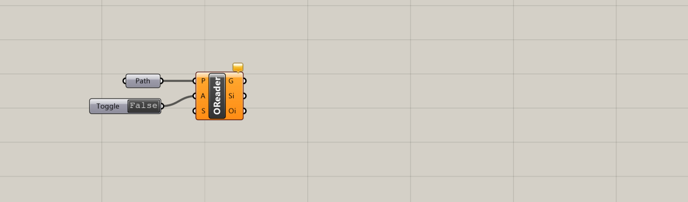

To activate the component a grasshopper native `Boolean toggle` component can be connected. Setting this component to active will active the `Reader Objects` component. Depending on the size and complexity of the file this can take a while to load.
It is recommend to set the preview geometry to wireframe if large files are processed. This will reduce the load on the system.

Once the processes of this component are finished the data is brought into grasshopper. The geometry is exposed via the `Geometry` output, the surface semantic information is via the `Surface Information` output, and the object semantic information is exposed via the `Object Information`.

## 1.2 Bring the CityJSON data into Rhino

Now that we have the data in Grasshopper it is fairly easy to move this data to rhino. This can be done in two different ways. The easiest way is to just bake the geometry output. This can be done if no semantic information related to the geometry is required. Just right click the component and press "Bake…". This will bake a 'naked' copy of the geometry into rhino.

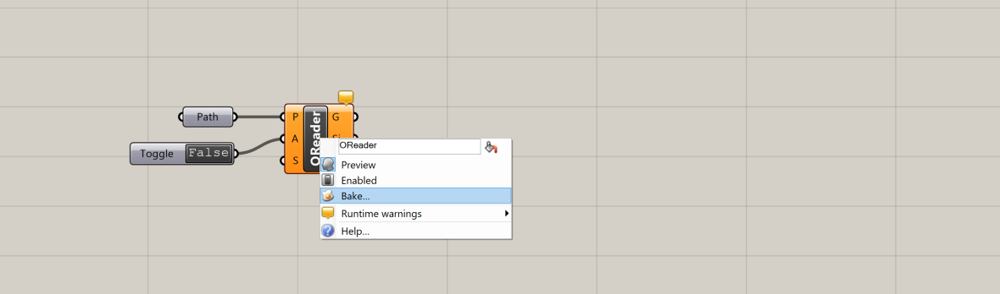

If semantic data is required some extra components are required. It is recommended to deactivate the `Reader Objects` component before moving on. We are going to make more connections to new components and if these are made incorrectly the components could load for a long time if the data-stream is active. De-activate the `Reader Objects` component by toggling the `Boolean toggle` to false.

Now `Information manager` component is required. This component will copy all the object information to all the surfaces information instances belonging to that object. It also does some filtering operations, but we will cover those later. Connect the `Geometry`, `Surface Information`, and  `Object Information` outputs of the `Reader Objects` component to the `Geometry`, `Surface Information`, and  `Object Information` inputs of the Information manager` component. Nothing happens, because the data stream is still disabled.

Following the `Information manager` component the `Bakery` component is required. This component will bake the data in Rhino. Connect the `Geometry` and `Merged Surface Information` outputs of the `Information manager` component to the `Merged Surface Information` inputs of the `Bakery` component.

Similar to the `Reader Objects` component the `Bakery` component has an `Activate` input. This works similar to the one of the `Reader Objects` component. If the input is true, the `Bakery` component will bake. I would recommend connecting a grasshopper native `Button` component. We only want to bake on pressing this button. If a toggle is used the bakery would bake the data to rhino every time the data-stream is updated.

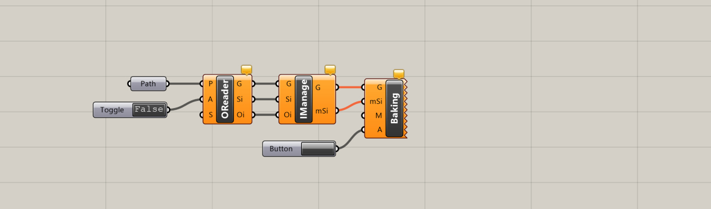

Now the `Boolean toggle` component connected to the `Reader Objects` component can be set to true again. This will rerun the script. Once the script is finished the button connected to the `Bakery` component can be pressed. This will bake the data to Rhino.

The data will stored in a layer structure containing some of the attribute data. The other data can be found in the "Attribute User Text" window in rhino. This window can be found under the "Properties" tab.

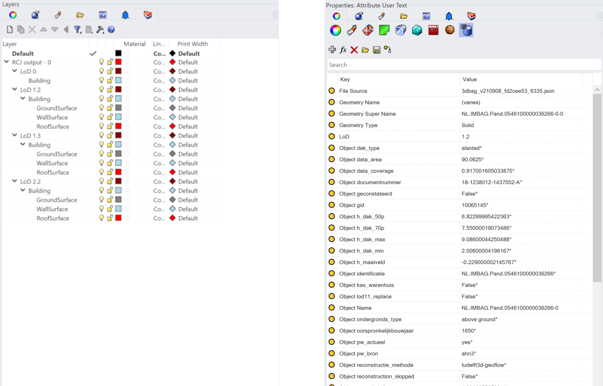

## 1.3 Fine tuning the CityJSON data input

The default behavior of the `Reader Objects` component might not be ideal for every situation. To be more flexible the default behavior can be changed. This can be done with the `Settings Reader` component. The `Settings Reader` component's output connects tot the `Reader Objects` component's `Settings` input. For the best workflow with large files it is recommended to disable the `Reader Objects` component while dialing in the settings. Once you are done, the `Reader Objects` component can be activated again.

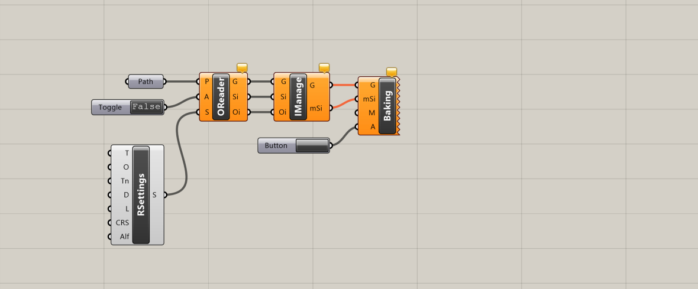

### Placement of the data

By default the `Reader Objects` component attempts to place the CityJSON geometry near the Rhino origin (0,0,0). This is not a precise operation and can be undesirable. The `Reader Objects` component computes the translation required based on the first file it receives. So, changing the files, or the order can also cause unpredictable behavior.

  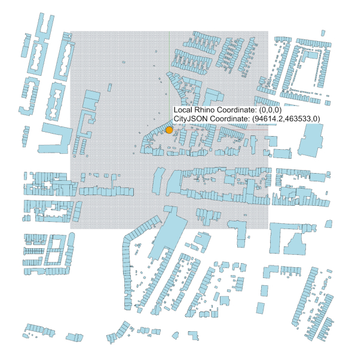

To resolve this local placement issue the `Translation` input of the `Settings Reader` component can be set to true with the help of a `Boolean toggle` component. This will place the CityJSON geometry at the coordinates that the geometry actually has.

The geometry will often be placed far from the local Rhino origin (0,0,0). To solve this a coordinate can be fed to the `Settings Reader` component via the `model origin` input. This input coordinate will be considered the origin and will place all the geometry in such a way that this coordinate becomes the local Rhino origin (0,0,0).

  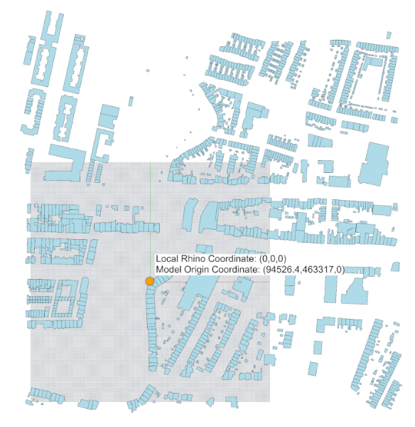

This setting is very useful if you have a mass study of a building that is placed near the local Rhino origin. Using this setting will place the mass in the middle of the environment and doesn’t require you to move the mass far away from the local origin or have to create new geometry far from the origin.

  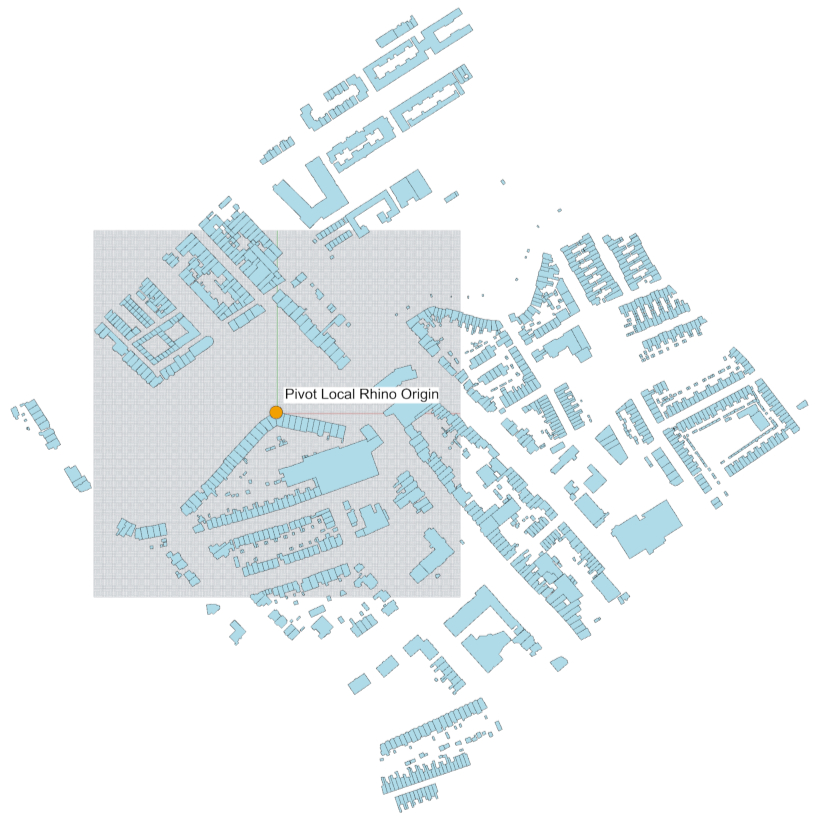

Possibly the XY plane of this mass study does not coincide with the true north. Modeling off grid can be challenging and more error prone. To prevent thsi is possible to rotate the CityJSON geometry around the local rhino origin. This can be done with the `True north` input of the `Settings Reader` component. This input takes a number value representing the XY rotation around local (0,0,0) counterclockwise in degrees.

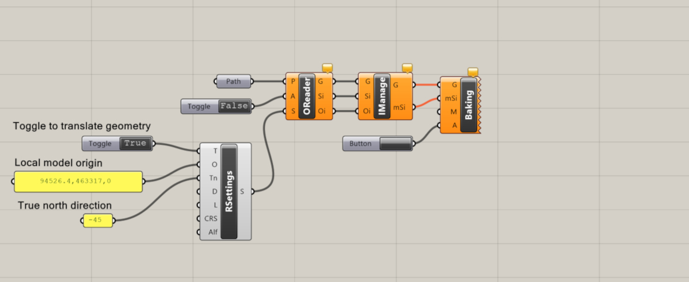

### filtering of geometry

By default the `Reader Objects` component loads in all the geometry that is available from the input file(s). This can be, depending on the input file(s), a heavy operation which is not always completeely required. If only the geometry of a certain LoD is required the `Settings Reader` component can be used to force the `Reader Objects` component to only load the required LoD. This can be done by creating a grasshopper native `Panel` component and typing the required LoD. If multiple LoD are required, every LoD must be on its own line and the `Panel` component must have multiline data toggled on. The output of the `Panel` component must be connected to the `LoD` input of the `Settings Reader` component.

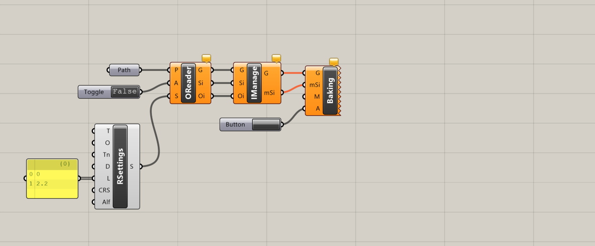

The `Settings Reader` component allows non-standard LoD, but it will give a warning if it encounters an unexpected LoD. This will not effect the subsequent processes.

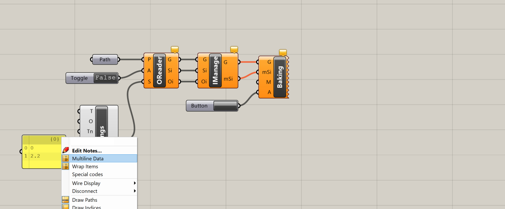

The geometry that the `Reader Objects` component loads in can also be limited by a spatial domain. If only a small area of the file is of importance this can drastically limit the memory usage. The domain can be constructed with any volumetric shape in Rhino or grasshopper (boxes, spheres, cones, and more). If Rhino geometry is used it has to be loaded into grasshopper with a native `geometry` component. The shape has to be fed into the `Domain` input of the `Settings Reader` component.

  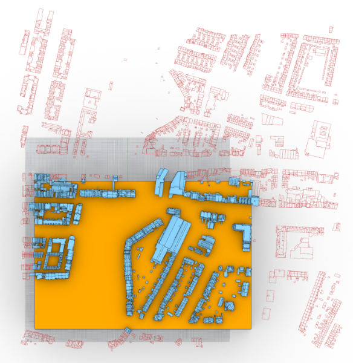

The domain is applied **After** the translation and rotation operations of the `Reader Objects` component. This means that the domain should be placed in local Rhino 3D space and not the CityJSON 3D space. The geometry that is filtered out is any shape that does not have a vertex that lies inside of the domain shape.

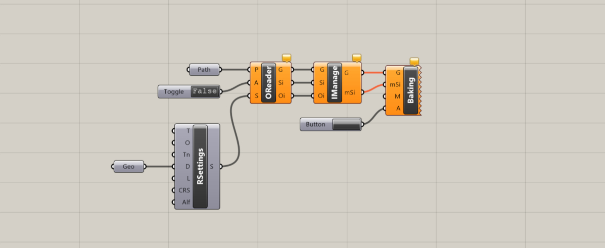

Currently only a single shape domain is supported, multiple shapes will cause issues.

### Reproject the data

Sometimes the data is not utilizing the same CRS. If you attempt to load this data at once via the `Reader Objects` component it will return an error. If you load it in by using two separate `Reader Objects` components you will notice that the data does not align and needs to manually corrected. To avoid this you can reproject the data to a different CRS. This will force the data to utilize a common CRS and be properly aligned.

The `Settings Reader` component's `Target CRS` input can be used for this. The input has to be a single string that represents the target CRS. The RhinoCityJSON plugin uses [PROJ](https://proj.org/en/stable/) to reproject data and thus accepts all the formats of defining a CRS that proj accepts. For example if the target CRS is EPSG:7415 (RD + NAP height) the input strings that would suit are: "EPSG:7415", "https://www.opengis.net/def/crs/EPSG/0/7415", or "urn:ogc:def:crs:EPSG::7415"

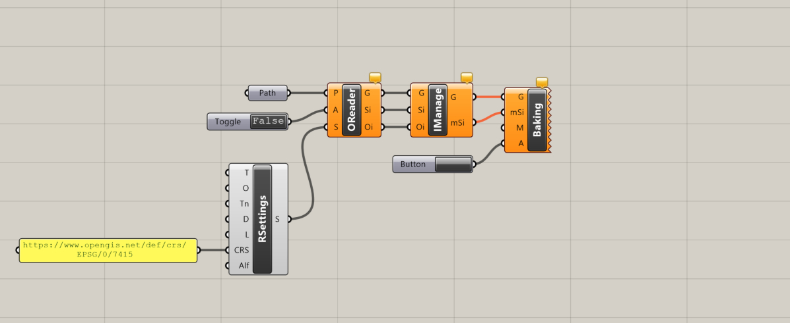

### Extremely large files

The `Reader Objects` component will stop functioning if it encounters a very large amount of data. This is to protect the user from accidentally freezing their session. If it is desired to load in a very large amount of data the `Settings Reader` component's `Large Files` input can be used to tell the `Reader Objects` component that. The input can be a grasshopper native `Boolean toggle` component. If set to true the `Reader Objects` component will not terminate the process for this reason anymore.

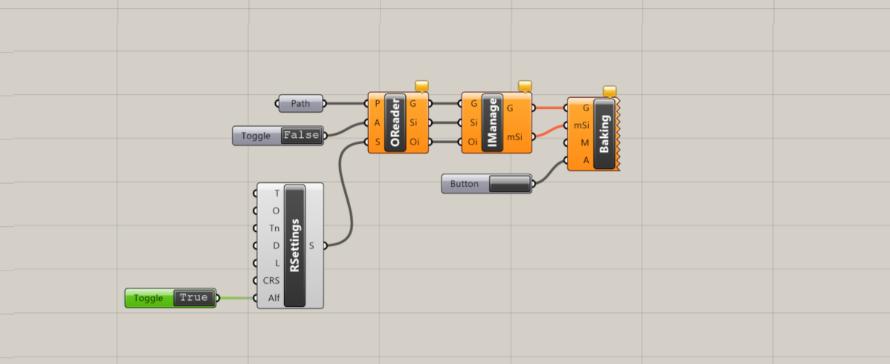

## 1.4 Fetching document data and materials

## 1.5 Opening Template data
